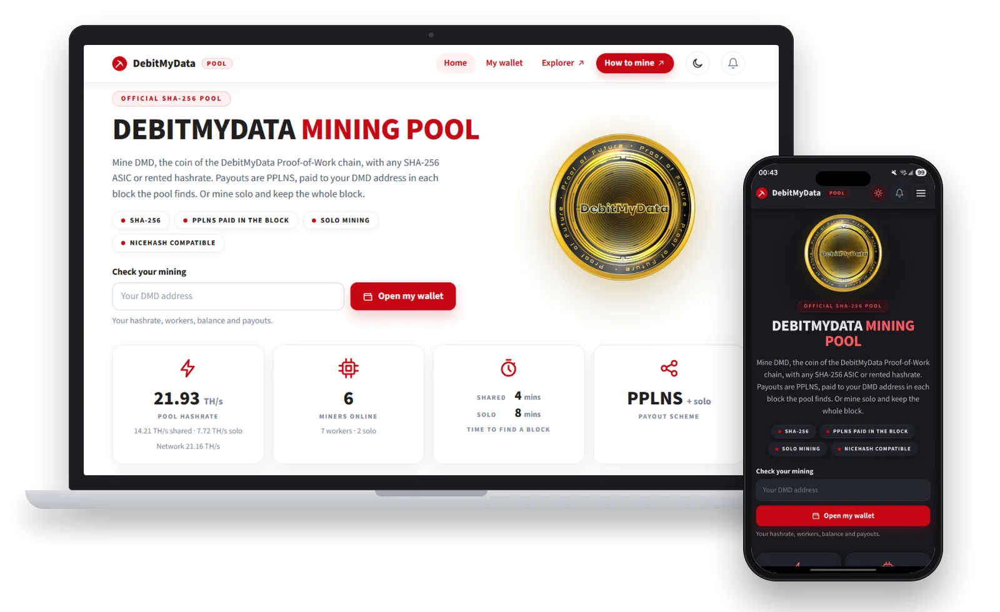
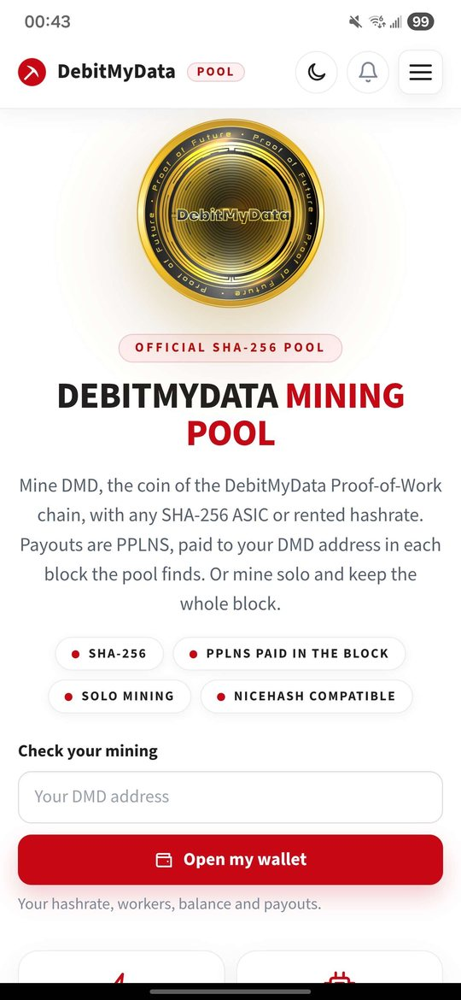
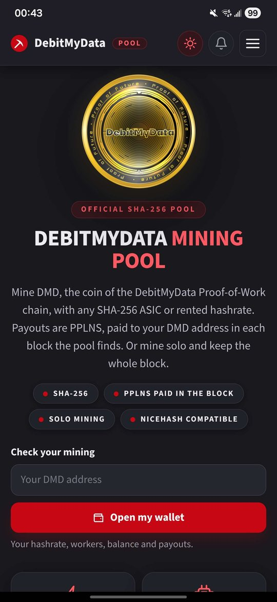

# DebitMyData mining pool (YiiMP)

The code of DebitMyData's official mining pool, **[pool.debitmydata.io](https://pool.debitmydata.io)**:
mining DMD, the native coin of the DebitMyData PoW chain (SHA-256), with PPLNS payouts
paid in the block itself.

It is based on [YiiMP](https://github.com/tpruvot/yiimp) by tpruvot, as continued by
cryptopool.builders and [le2Ks](https://github.com/le2Ks/yiimp). Their full history is kept in
this repository.

<picture>
  <source media="(prefers-color-scheme: dark)" srcset="docs/images/pool-devices-dark.webp">
  
</picture>

## What DebitMyData added

- **PPLNS paid in the coinbase**, with an optional solo mode (password `m=solo`):
  `stratum/pplns.cpp`, `stratum/pplns.h`, `sql/2026-11-12-pplns-coinbase.sql`.
- **My wallet** (`/mywallet/<address>`): a miner's workers, earnings, payouts and blocks, with
  notifications on the phone or the computer (web push): `web/yaamp/modules/mywallet/`,
  `web/yaamp/core/backend/push.php`, `sql/2026-11-13-push.sql`, `sql/2026-11-12-push-test.sql`.
- **An installable app** (below): `web/manifest.json`, `web/sw.js`, `web/images/app/`,
  `web/yaamp/ui/dmd-app.php`.
- **DebitMyData's design**, in light and dark: `web/yaamp/ui/css/dmd-pool.css`,
  `web/yaamp/ui/dmd-app.php`, `web/yaamp/ui/main.php`.
- Pages the pool doesn't use (renting, trading, benchmarks, stats and a few others) were
  removed.

## The pool app

The website installs as an app, **DMD Pool**, on phones, tablets and computers: its own icon,
a launch screen, and no browser bars. There is nothing to download from a store.

- **It offers itself.** On a phone or tablet, a window offers the app a moment after a page
  opens. On any device, **Get the app** in the footer opens it.
- **It knows the device.** On an iPhone or iPad, it shows the two taps: Share, then Add to Home
  Screen. On Android, the browser's menu, then Install app. Where the browser installs it in one
  tap (Chrome, Edge, Samsung Internet), an Install button.
- **It doesn't insist.** It is never offered inside the app, nor once the browser says the app is
  installed (the web app, or the Google Play version below), and "Not now" is remembered for 30
  days.
- **Notifications.** The bell turns on notices for new blocks and payouts. On an iPhone, they work
  in the app added to the Home Screen.
- **Light and dark**, remembered on each device.

**A Google Play version** (a Bubblewrap app) can be listed in `web/manifest.json`: in Chrome and
Edge on Android, the page then sees it once it is installed and does not offer the browser
version.

  
  &nbsp;
  

The service worker (`web/sw.js`) also shows a short page when there is no network, and the
notifications themselves.

## Installation

The pool runs on **Ubuntu 24.04 with PHP 8.3**, MariaDB 10.11 and nginx. The
[DebitMyData pool installer](https://github.com/DebitMyData-PoW/Multi-Pool-Installer) sets it all
up on a fresh server. See **[INSTALL.md](INSTALL.md)** for how, the database changes, and what this
repository leaves out (settings, secrets and licensed fonts stay on the server).

## Security

To report a security problem, write to info@debitmydata.com with the subject line
`Security: DebitMyData pool`. Please don't open a public issue for it.

## Credits

- [tpruvot](https://github.com/tpruvot/yiimp), for YiiMP
- cryptopool.builders and Original-Tasty, for their fork and installer
- [le2Ks](https://github.com/le2Ks/yiimp), for the version this pool was installed from
